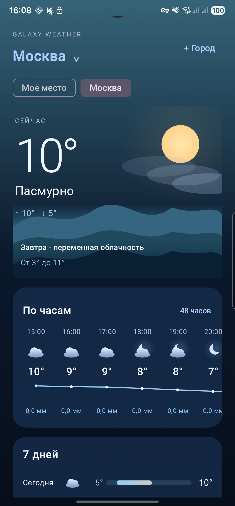
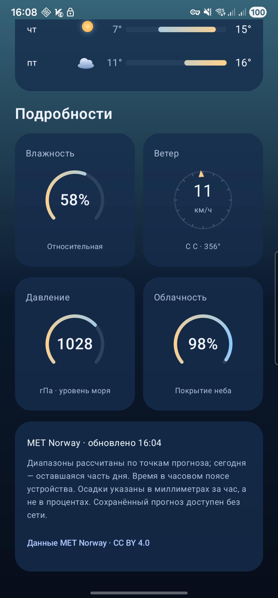
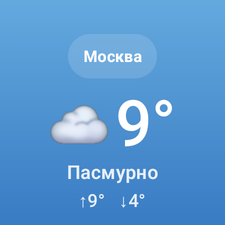

<div align="center">

# Galaxy Weather

### Погода на телефоне. Тот же город на часах.

Анимированный интерфейс · Сохранённые города · Виджет · Wear OS


**[Скачать для телефона](https://github.com/Kiribuga/GalaxyWeather/releases/download/v0.1.3/GalaxyWeather-phone-0.1.3-release.apk)** · **[Скачать для часов](https://github.com/Kiribuga/GalaxyWeather/releases/download/v0.1.3/GalaxyWeather-wear-0.1.3-release.apk)** · **[Все релизы](https://github.com/Kiribuga/GalaxyWeather/releases)**

</div>

Galaxy Weather — приложение на русском языке для Android и Wear OS. Текущая погода, почасовой прогноз, семь дней, сохранённые города и передача выбранного на телефоне профиля на часы. Данные предоставляет MET Norway; API-ключ для использования не нужен.

## Интерфейс

<table>
<tr><th>Погода и почасовой прогноз</th><th>Подробности</th><th>На запястье</th></tr>
<tr>
<td align="center"></td>
<td align="center"></td>
<td align="center"></td>
</tr>
</table>

Реальные снимки релиза 0.1.3 на Galaxy S22 Ultra и Galaxy Watch4 Classic. Погода соответствует моменту съёмки.

## Возможности

| Телефон | Часы |
| --- | --- |
| Анимированный пейзаж, дневная и ночная палитры | Крупная температура и значок текущей погоды |
| Почасовая лента на 24/48 часов, график и осадки | Почасовой прогноз и список дней |
| Прогноз на семь дней | Карточка Wear OS Tile |
| Влажность, ветер, давление и облачность | Усложнение циферблата: значок и температура |
| Обновление свайпом вниз | Касание усложнения открывает приложение |
| Поиск города и сохранённые вкладки | Прокрутка касанием и вращающимся органом управления |
| «Моё место» с запросом разрешения | Сначала прогноз телефона, затем резервная сеть |
| Виджет с крупными часами и ближайшими часами прогноза | Всегда профиль, выбранный на телефоне |
| Прозрачность виджета меняется ползунком поверх рабочего стола | Сохранённый прогноз доступен без сети |

## Поддерживаемые устройства

Минимальные версии определяются настройками APK. Проверка одной модели не означает проверку всей линейки.

| Устройство | Требования | Статус |
| --- | --- | --- |
| **Samsung Galaxy S22 Ultra, SM-S908E** | Проверен на Android 16 / API 36 | Релиз установлен и запущен |
| **Samsung Galaxy Watch4 Classic LTE 46 мм, SM-R895F** | Проверен на Android 16 / API 36 | Релиз установлен, получен прогноз телефона |
| Другие телефоны Samsung Galaxy, Google Pixel, Xiaomi, OnePlus и других производителей | Android **8.0+ / API 26+** | Ожидаемая совместимость по требованиям APK; отдельные модели не проверены |
| Galaxy Watch4 и более новые Samsung с Wear OS; Google Pixel Watch и другие часы с Wear OS | Wear OS **3+**, Android **11+ / API 30+**, Google Play services | Ожидаемая совместимость; кроме SM-R895F аппаратная проверка не проводилась |

Для связи телефона и часов нужны Google Play services и штатное сопряжение. Производитель телефона не ограничен кодом, но производитель часов может устанавливать более высокий минимум Android для сопряжения.

**Не поддерживаются:** iPhone/iOS, Apple Watch, Tizen (Galaxy Watch, Watch Active/Active2, Watch3), HarmonyOS и другие платформы без Wear OS, Wear OS 2, Android ниже указанных минимумов. Связь с часами без Google Play services не поддерживается; отдельная работа телефона на таких прошивках не проверена.

[Подробности совместимости и официальные источники](docs/COMPATIBILITY.md).

## Установка

1. Скачайте **phone APK** на телефон и установите его, разрешив установку из выбранного источника по запросу Android.
2. Откройте приложение, выберите город либо «Моё место». Геолокация необязательна: при отказе обновляется текущий город.
3. Сопрягите часы с телефоном через приложение производителя. Установите **wear APK** на часы через Android Studio/ADB по Wi-Fi.
4. Откройте приложение на телефоне, затем на часах. Часы получат выбранный профиль и прогноз.
5. Виджет добавляется средствами рабочего стола Android; Tile и усложнение — средствами Wear OS/редактора циферблата.

```powershell
adb -s PHONE_SERIAL install -r GalaxyWeather-phone-0.1.3-release.apk
adb connect WATCH_IP:DEBUG_PORT
adb -s WATCH_IP:DEBUG_PORT install -r GalaxyWeather-wear-0.1.3-release.apk
```

Первое Wi-Fi подключение требует штатного сопряжения `adb pair`. Если ранее стояла debug/preview-версия, её подпись отличается от release: обновление поверх не пройдёт. Удаление старого приложения очистит настройки и кеш; виджет и усложнение потребуется добавить/выбрать снова. Следующие релизы с тем же постоянным ключом можно обновлять обычным способом.

[SHA256SUMS.txt](https://github.com/Kiribuga/GalaxyWeather/releases/download/v0.1.3/SHA256SUMS.txt) содержит контрольные суммы APK. Оба приложения подписаны одним сертификатом.

## Как связаны телефон и часы

Телефон передаёт название места, координаты выбранного профиля и готовый прогноз через Wear OS Data Layer. Часы сначала читают свежий прогноз телефона. Если его получить не удалось, они обращаются к сети **для последнего полученного профиля телефона**. До первого получения профиля часы предлагают открыть приложение на телефоне.

Кеш позволяет показывать ранее загруженные данные без сети. Геолокация проверяется при возвращении в приложение и каждые пять минут, пока оно открыто; постоянного фонового отслеживания нет. [Данные и разрешения](docs/PRIVACY.md).

## Сборка из исходников

Откройте **GalaxyWeather/** в Android Studio. Проверенная среда: JBR 25, Gradle 9.6.0, AGP 9.4.1, Compose compiler plugin 2.2.10. Установите SDK 37 (mobile) и 35 (wear/shared). Целевой байткод — Java 17.

```powershell
.\GalaxyWeather\build.ps1 -Tasks ':mobile:assembleDebug',':wear:assemblePreview',':shared:testDebugUnitTest'
```

Для постоянной подписи: **Build → Generate Signed Bundle / APK**, один ключ для обоих модулей. Пароли и приватное хранилище не входят в репозиторий. Обычный assembleRelease без параметров подписи создаёт unsigned APK. [Инструкция сборки](docs/BUILDING.md).

## Проверки и ограничения

До выпуска пройдены 6 unit-тестов shared, 8 инструментальных проверок телефона и 2 часов. Android Lint: 0 ошибок, 23 предупреждения телефона и 15 часов. OSV: 152 зависимости, 0 возвращённых advisories; это не гарантия отсутствия неизвестных уязвимостей. Проверены подписи, целостность и выравнивание APK на 16 КБ.

Инструментальные тесты выполнялись на debug/preview; подписанные release отдельно установлены и проверены запуском и передачей прогноза. Другие модели, длительное потребление батареи, все размеры экранов и реальное устройство с 16-КБ страницами памяти не проверены. Релиз **0.1.3** ранний. [Результаты проверок](docs/RELEASE_NOTES.md).

Диапазон текущего дня учитывает оставшиеся точки прогноза. Время — в часовом поясе устройства, осадки — в миллиметрах за час. Карта, УФ-индекс, видимость, восход/закат и вероятность осадков не реализованы; отсутствующие показатели не выдумываются.

## Источники данных

- Погода: **[MET Norway Locationforecast](https://api.met.no/doc/Locationforecast/2.0)**, [CC BY 4.0](https://api.met.no/doc/License).
- Поиск: **[Nominatim](https://nominatim.org/)**, © [OpenStreetMap contributors](https://www.openstreetmap.org/copyright). Явный поиск, без автодополнения, с ограничением частоты и кешем.
- Связь устройств: [Wear OS Data Layer](https://developer.android.com/training/wearables/data/overview).

Проект не является официальным приложением Samsung или Google.
